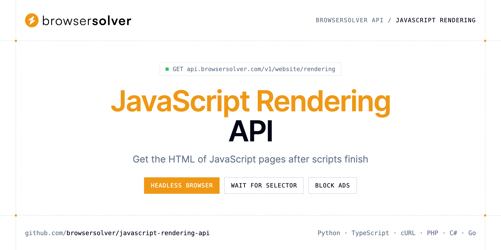

<p align="center">
  <a href="https://www.browsersolver.com"></a>
</p>

# JavaScript Rendering API

[](https://discord.gg/CFj3ph8aHU) [](https://app.browsersolver.com/register) [](https://app.browsersolver.com/openapi) [](LICENSE)

The **BrowserSolver JavaScript Rendering API** loads a public URL in a managed headless browser and returns the HTML once client-side scripts have finished — no Chromium fleet to run.

- **JavaScript Rendering API** — Run a managed browser session against a public URL and collect the HTML after client-side scripts finish.

Use it for single-page apps, infinite lists and any site whose content only appears after JavaScript runs.

| Endpoint | Request | Credits |
|---|---|---|
| [JavaScript Rendering API](#javascript-rendering-api) | `GET /v1/website/rendering` | 2 |

## Table of contents

- [How it works](#how-it-works)
- [JavaScript Rendering API](#javascript-rendering-api)
- [Code examples in other languages](#code-examples-in-other-languages)
- [Use cases](#use-cases)
- [Why BrowserSolver?](#why-browsersolver)
- [FAQ](#faq)
- [Related repositories](#related-repositories)
- [Support](#support)

## How it works

1. **Create a BrowserSolver account** and copy your API key from the [dashboard](https://app.browsersolver.com/register).
2. **Call `https://api.browsersolver.com`** with the header `x-api-key: YOUR_API_KEY`.
3. **Use the result** in your app — no infrastructure to run.

```bash
export BROWSERSOLVER_API_KEY="your-api-key"
pip install requests        # Python
# TypeScript: Node.js 18+ (native fetch), run with `npx tsx file.ts`
```

## JavaScript Rendering API

Run a managed browser session against a public URL and collect the HTML after client-side scripts finish. Prefer Crawler for static markup; escalate to WebUnlocker on approved hosts when challenges persist.

`GET https://api.browsersolver.com/v1/website/rendering` · **2 credits per request** · [API reference](https://app.browsersolver.com/openapi)

### Request parameters

| Parameter | In | Type | Required | Description |
|---|---|---|---|---|
| `query` | query | string | ✅ | Public URL to load inside BrowserSolver's headless browser. Include `http://` or `https://`. |
| `wait_in_seconds` | query | number | — | Extra pause, in seconds, after the page load event before BrowserSolver returns HTML. Helpful when widgets animate or hydrate late. |
| `wait_for` | query | string | — | CSS or XPath selector that must appear in the DOM before HTML is returned. The managed browser waits until the node exists (or until `timeout`). |
| `block_ads` | query | boolean | — | Skip ad-network requests while the page renders. |
| `timeout` | query | number | — | Hard ceiling, in seconds, for the render session. When reached, BrowserSolver returns whatever HTML is available. |

### Python example

```python
import os

import requests

API_KEY = os.environ["BROWSERSOLVER_API_KEY"]
HEADERS = {"x-api-key": API_KEY}

response = requests.get(
    "https://api.browsersolver.com/v1/website/rendering",
    headers=HEADERS,
    params={
        "query": "https://quotes.toscrape.com/js/",
    },
    timeout=120,
)
response.raise_for_status()

data = response.json()
print(data)
```

### TypeScript example

```typescript
type JavascriptRenderingApi = string;

const headers = { "x-api-key": process.env.BROWSERSOLVER_API_KEY!, "Content-Type": "application/json" };

const params = new URLSearchParams({
  "query": "https://quotes.toscrape.com/js/",
});

const response = await fetch(`https://api.browsersolver.com/v1/website/rendering?${params}`, { headers });
if (!response.ok) throw new Error(`HTTP ${response.status}: ${await response.text()}`);

const data = (await response.json()) as JavascriptRenderingApi;
console.log(data);
```

### Output example

Example response from the API reference, abridged.

```json
"<!DOCTYPE html><html lang=\"en\"><head><meta charset=\"utf-8\"><title>Shipping faster with edge caches | Engineering Notes</title><script src…"
```

## Code examples in other languages

Ready-to-run examples live in [`examples/`](examples); each reads your key from `BROWSERSOLVER_API_KEY`.

| Language | `rendering` |
|---|---|
| cURL (Bash) | [rendering.sh](examples/curl/rendering.sh) |
| PHP | [rendering.php](examples/php/rendering.php) |
| C# | [Rendering.cs](examples/csharp/Rendering.cs) |
| Go | [rendering.go](examples/go/rendering.go) |
| Java | [RenderingExample.java](examples/java/RenderingExample.java) |
| Ruby | [rendering.rb](examples/ruby/rendering.rb) |
| Node.js | [rendering.mjs](examples/nodejs/rendering.mjs) |

## Use cases

- **Single-page apps** — Scrape React, Vue or Angular pages that ship an empty HTML shell.
- **Wait for content** — Return only once a CSS or XPath selector exists with `wait_for`.
- **Lighter pages** — Block ads during the session with `block_ads`.
- **Replace Puppeteer** — Drop your own headless browser servers.

## Why BrowserSolver?

- **Three fetch tiers** — Crawler for static HTML, Rendering for JavaScript pages, WebUnlocker for hosts that still challenge a headless browser.
- **Know before you fetch** — the Antibot endpoint names the bot-protection vendor in front of a URL so you can choose the right tier.
- **Screenshots as a service** — PNG, JPEG, WebP or PDF, full page, 18 device presets, cookie banner and ad removal, S3 upload.
- **Technology detection** — CMS, frameworks, analytics, CDN and security tooling of any public URL.
- **Copy-paste examples** — Python and TypeScript in each README, 7 more languages in `examples/`.

## FAQ

### How do I authenticate?

Create an account on [BrowserSolver](https://app.browsersolver.com/register), copy your API key and send it in the `x-api-key` header of every request to `https://api.browsersolver.com`.

### How much does a request cost?

Credits per call: `/v1/website/rendering` **2**. See [BrowserSolver pricing](https://www.browsersolver.com/pricing).

### How do I wait for dynamic content?

Pass a CSS or XPath selector in `wait_for`; the browser waits until it exists or until `timeout` (seconds) is reached.

### When should I use Crawler instead?

If the HTML already contains your data, the Crawler tier is faster and cheaper (1 credit instead of 2).

### Which languages are supported?

Any language that can make an HTTP request. This README shows Python and TypeScript; the [`examples/`](examples) folder contains cURL, PHP, C#, Go, Java, Ruby and Node.js.

## Related repositories

- [Web Unlocker API](https://github.com/browsersolver/web-unlocker-api)
- [Web Crawler API](https://github.com/browsersolver/web-crawler-api)
- [Screenshot API](https://github.com/browsersolver/screenshot-api)
- [Antibot Detection API](https://github.com/browsersolver/antibot-detection-api)
- [Website Technology API](https://github.com/browsersolver/website-technology-api)
- [All BrowserSolver repositories](https://github.com/browsersolver)

## Support

- 💬 Join the [Discord](https://discord.gg/CFj3ph8aHU) to ask questions and share what you build.
- 📚 Read the [API reference](https://app.browsersolver.com/openapi).
- 🔑 [Get your API key](https://app.browsersolver.com/register).

---

<p align="center">
  <a href="https://www.browsersolver.com">
    <picture>
      <source media="(prefers-color-scheme: dark)" srcset="images/logo-dark.svg">
      
    </picture>
  </a>
  <br>
  <sub>Built by <a href="https://www.browsersolver.com">BrowserSolver</a>. Examples are released under the MIT license.</sub>
</p>
